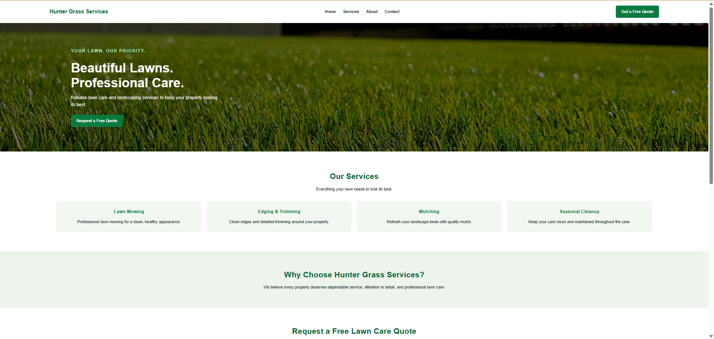
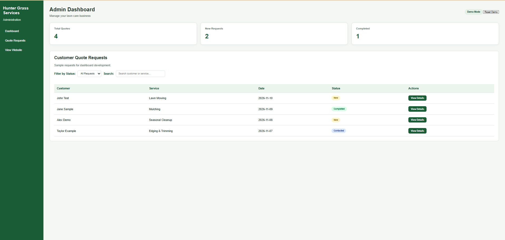
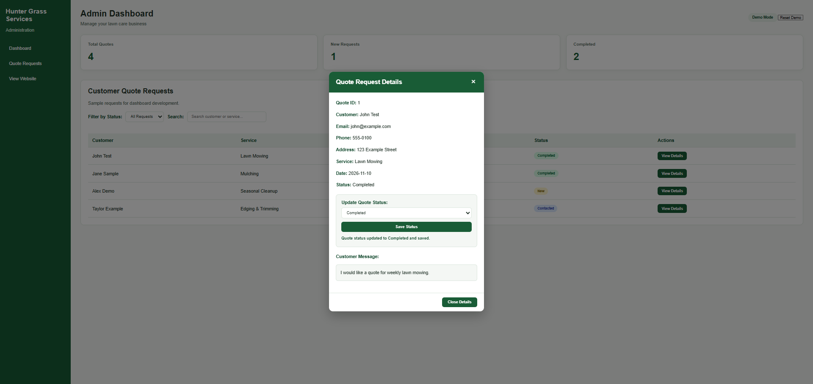

# Hunter Grass Services

### Professional Lawn Care Website & Quote Management System

A full-stack lawn care business website built with **C#, .NET 10, ASP.NET Core Minimal API, HTML, CSS, JavaScript, Entity Framework Core, SQLite, and ASP.NET Core Identity**.

Hunter Grass Services allows customers to explore lawn care services and submit online quote requests. The application uses an ASP.NET Core backend to validate and process customer submissions and Entity Framework Core to store requests in a SQLite database.

The project also includes an interactive administrative dashboard demonstrating quote management, customer search, status filtering, and browser-based persistence, with an ASP.NET Core Identity foundation for future secure administrative access.

This project demonstrates full-stack web development, REST API integration, database management, authentication and authorization concepts, responsive design, and Git/GitHub version control.

---

## Project Screenshots

### Public Website

A responsive lawn care business homepage featuring professional landscaping imagery, service information, business navigation, and a free quote request form.

### Admin Dashboard

An interactive administrative dashboard featuring quote statistics, customer search, status filtering, color-coded status indicators, and quote management.

### Quote Details Dialog

An interactive dialog displaying sample customer information, requested services, customer messages, and quote status update controls.

> **Note:** The admin dashboard currently operates in Demo Mode using fictional customer records. Secure administrator login and database-backed quote management are planned for a future development phase.

---

## Features

### Responsive Business Website

- Modern lawn care website with mobile-friendly styling
- Homepage with professional lawn care imagery and business information
- Responsive navigation menu
- Service cards highlighting available lawn care services
- About section describing the business
- Contact and free quote request form

### Customer Quote Request System

- Customers can submit quote requests online
- JavaScript uses the Fetch API to communicate with the backend
- ASP.NET Core Minimal API processes customer submissions
- Server-side validation using Data Annotations
- Success and error messages displayed to customers
- Customer quote requests stored in SQLite
- Automatically generated request IDs and UTC timestamps

### Admin Dashboard — Demo Mode

- Responsive administrative dashboard with sidebar navigation
- Dashboard statistics displaying total, new, and completed quotes
- Interactive customer quote request table
- Customer search by name or requested service
- Filter quote requests by status
- Color-coded status indicators
- View Details dialog displaying individual quote information
- Update quote statuses directly from the details dialog
- Automatically refresh dashboard statistics after status changes
- Browser localStorage persistence for demo status updates
- Reset Demo functionality to restore original sample data

The dashboard currently uses fictional sample records to demonstrate administrative functionality without exposing real customer information.

### Database Integration

- Entity Framework Core for database access
- SQLite for persistent data storage
- Code-first database migrations
- Automatically generated quote request IDs
- UTC timestamps for submitted requests
- ASP.NET Core Identity database tables
- Shared database context supporting quote requests and Identity entities

### Authentication & Authorization Foundation

- ASP.NET Core Identity configuration
- Identity user and role support
- Administrator-only authorization policy
- Cookie-based authentication configuration
- Password complexity requirements
- Account lockout configuration
- Secure and HttpOnly cookie settings
- Authentication and authorization middleware
- .NET User Secrets initialization for future administrator credentials

Administrator account creation, login functionality, protected dashboard access, and secure retrieval of real customer records are planned for the next development phase.

---

## Technologies Used

| Category | Technology |
|---|---|
| Programming Language | C# |
| Framework | .NET 10 |
| Backend | ASP.NET Core Minimal API |
| Frontend | HTML5, CSS3, JavaScript |
| API Communication | Fetch API |
| Database | SQLite |
| ORM | Entity Framework Core 10 |
| Authentication Foundation | ASP.NET Core Identity |
| Authorization | Role-Based Authorization |
| Authentication Configuration | Cookie Authentication |
| Client-Side Storage | Browser localStorage |
|